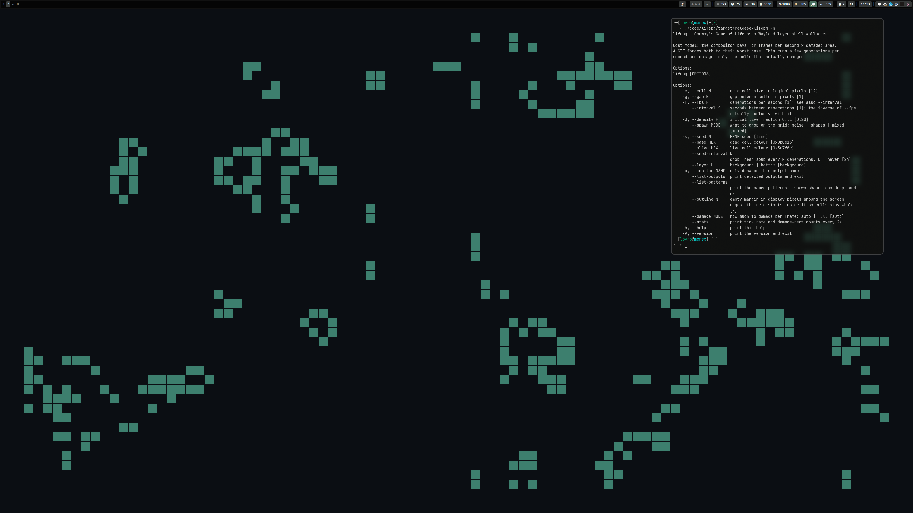

# lifebg

Conway's Game of Life as a Wayland layer-shell wallpaper.



The point is that it's cheap to composite. An animated GIF makes the compositor
redraw the whole screen 30 to 60 times a second. A Game of Life grid is mostly
unchanged from one generation to the next, so this runs one generation every few
seconds and only asks the compositor to repaint the cells that actually flipped.

## Build and run

```sh
cargo build --release
./target/release/lifebg --spawn shapes --interval 1
```

Nothing gets installed and nothing is added to your session startup. Stop it with
`pkill -x lifebg`.

## Options

```
    -c, --cell N        grid cell size in logical pixels [12]
    -g, --gap N         gap between cells in pixels [1]
    -f, --fps F         generations per second [1]; see also --interval
        --interval S    seconds between generations [1]; the inverse of --fps,
                        mutually exclusive with it
    -d, --density F     initial live fraction 0..1 [0.28]
        --spawn MODE    what to drop on the grid: noise | shapes | mixed [mixed]
    -s, --seed N        PRNG seed [time]
        --base HEX      dead cell colour [0x0b0e13]
        --alive HEX     live cell colour [0x3d7f6e]
        --seed-interval N
                        drop fresh soup every N generations, 0 = never [24]
        --layer L       background | bottom [background]
    -o, --monitor NAME  only draw on this output name
        --list-outputs  print detected outputs and exit
        --list-patterns print the named patterns --spawn shapes can drop, and exit
        --outline N     empty margin in display pixels around the screen edges;
                        the grid starts inside it so cells stay whole [0]
        --damage MODE   how much to damage per frame: auto | full [auto]
        --stats         print tick rate and damage-rect counts every 2s
    -h, --help          print this help
    -V, --version       print the version and exit
```

## Spawn modes

`--spawn noise` fills the screen with random cells. It evolves, but after a
generation or two it looks like tinted static. It's also expensive: most of the
grid changes every generation, so there is nothing worth clipping the damage to
and every frame ends up damaging the whole surface.

`--spawn shapes` starts on an empty grid and drops recognisable patterns —
gliders, LWSS, blinkers, toads, beacons, pulsars, and now and then a Gosper
glider gun. This is the one to use. It looks better, and it's the mode where
partial damage actually does something. `--list-patterns` prints the set.

`--spawn mixed` does both at once. It's the current default, which is probably
wrong, since the noise dominates and you get the worst of each.

## How the damage works

Changed cells get merged into rectangles before being handed to the compositor:
contiguous cells in a row collapse into a run, and a run in the next row with
identical geometry extends that rectangle downward.

If the merged rectangles end up covering more than half the surface, or there are
more of them than one per sixteen cells, it gives up and damages the whole
surface instead, because at that point clipping costs more than it saves. Both
limits are relative to the grid. An absolute rectangle count means something
different at every resolution and cell size, and an early absolute limit of 256
sat there quietly forcing full-surface damage for a long time before anyone
noticed.

`--damage full` skips the merging so you can compare the two. `--stats` prints
how much of the surface each frame damages.

## Notes for whoever edits this next

Fractional scaling. On a fractional-scaled output Hyprland will not accept a
layer surface sized with an integer `wl_surface.buffer_scale`. The buffer has to
be `logical_size × fractional_scale`, the logical size has to be declared through
`wp_viewport`, and a `wl_shm` buffer whose size is not page-aligned gets
rejected. Get any of that wrong and the compositor kills the client with a bare
`EPIPE` and no readable protocol error. There is a longer write-up at the top of
`src/app.rs`.

Damage coordinates are logical, not buffer coordinates. The viewport does the
scaling. Passing buffer-space rectangles makes the compositor repaint the wrong
regions and leave stale cells behind.

Hotplug. `sync_monitors` runs every loop iteration. New outputs get a surface,
surfaces whose output disappeared get dropped, and one output going away does not
take the others down with it.

## Layout

- `src/main.rs` — CLI, event loop, stats
- `src/app.rs` — Wayland: layer shell, shm buffers, damage, viewport and fractional scale
- `src/sim.rs` — Game of Life and pattern seeding
- `src/paint.rs` — palette and damage-rect merging

`cargo test` runs 15 tests, covering the pattern behaviour and the rectangle
merging.

